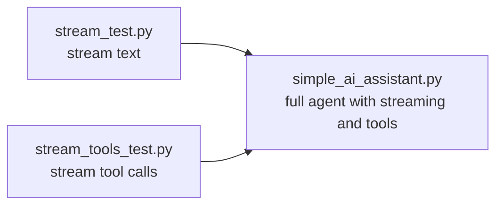

<div align="center">


</div>

<br/>

## 🧪 What is this folder?

These are **small, standalone snippets**, one for each feature we integrated step by step into the main agent code (`simple_ai_assistant.py`, `tools.py` and friends).

Each snippet isolates **one idea** so you can run it, break it and understand it *before* seeing it inside the full agent. Think of this folder as the lab, and the root of the repo as the finished product. 🔬➡️🚀

> 🎬 Part of the **Advanced AI** series on [codestorywithMIK](https://www.youtube.com/@codestorywithMIK).

<br/>

## 📂 Snippets

| File | Feature | What you learn |
|---|---|---|
| 📝 [`stream_test.py`](./stream_test.py) | **Streaming `message.content`** | Print the model's answer token by token as it is generated, instead of waiting for the full reply |
| 🔧 [`stream_tools_test.py`](./stream_tools_test.py) | **Streaming `tool_calls`** | Handle tool requests that arrive in small pieces while streaming, and put them together before running the tool |

<br/>

## 🧩 How they connect to the main agent



Learn each piece alone first, then see how they combine in the real agent.

<br/>

## ⚡ How to run

Set up the project first by following the **Quick start** in the [main README](../README.md): Ollama running, model pulled, virtual environment active, `.env` created.

Then, from the **project root**:

```bash
python "Code Snippets/stream_test.py"
python "Code Snippets/stream_tools_test.py"
```

<br/>

## 💡 Tips

- Read the snippet first, run it second, then compare it with the matching part of the main agent.
- Change one thing at a time (the prompt, the model, the tool) and watch what changes in the output.
- Small local models can be unpredictable with tools. If a snippet behaves oddly, try a larger model.

<br/>

<div align="center">

### ⭐ If these snippets helped you, a star on the repo goes a long way!


</div>
