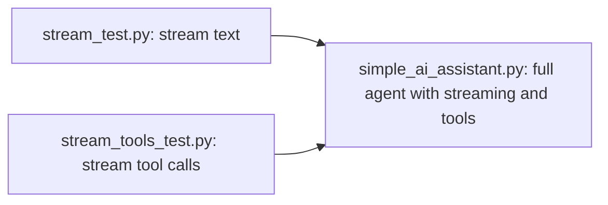
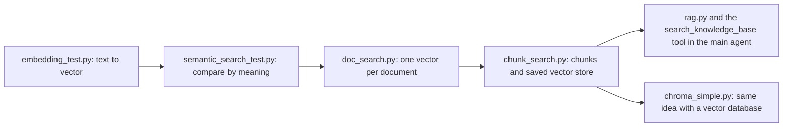

<div align="center">


</div>

<br/>

## 🧪 What is this folder?

These are **small, standalone snippets**, one for each feature we integrated step by step into the main agent code (`simple_ai_assistant.py`, `tools.py`, `rag.py` and friends).

Each snippet isolates **one idea** so you can run it, break it and understand it *before* seeing it inside the full agent. Think of this folder as the lab, and the root of the repo as the finished product. 🔬➡️🚀

> 🎬 Part of the **Advanced AI** series on [codestorywithMIK](https://www.youtube.com/@codestorywithMIK).

<br/>

## 📂 Snippets

| File | Feature | What you learn |
|---|---|---|
| 📝 [`stream_test.py`](./stream_test.py) | **Streaming `message.content`** | Print the model's answer token by token as it is generated, instead of waiting for the full reply |
| 🔧 [`stream_tools_test.py`](./stream_tools_test.py) | **Streaming `tool_calls`** | Handle tool requests that arrive in small pieces while streaming, and put them together before running the tool |
| 🧬 [`embedding_test.py`](./embedding_test.py) | **Embeddings** | Turn text into a list of numbers (a vector) using an embedding model, and see that each text gets a vector of the same length |
| 🔍 [`semantic_search_test.py`](./semantic_search_test.py) | **Cosine similarity** | Compare texts by meaning. "Python is a programming language" scores much closer to another Python sentence than to one about apples |
| 📚 [`doc_search.py`](./doc_search.py) | **Search over documents** | Load the files in `knowledge_base/`, create **one embedding per document**, and rank documents for a question with `top_k`. It also exposes the problems of this first version: blurry vectors, re-embedding on every start and too much text |
| ✂️ [`chunk_search.py`](./chunk_search.py) | **Chunking and a saved vector store** | Split each document into chunks (one section = one chunk, with `source` and `chunk_id`), embed them once, save everything to `vector_store.json`, and load it on the next start |
| 🗄️ [`chroma_simple.py`](./chroma_simple.py) | **Vector database with ChromaDB** | Replace the hand-made `vector_store.json` and the manual cosine code with a real vector database. Store chunks (`ids`, `documents`, `embeddings`) in a persistent **Chroma collection** with cosine distance, use `upsert` so re-runs never create duplicates, and fetch the closest chunk for a question with `query(n_results=...)` |

<br/>

## 🧩 How they connect to the main agent

**Streaming:**



**RAG:**



Learn each piece alone first, then see how they combine in the real agent. The code in `rag.py` was **copied from these snippets**, so nothing in the main agent imports from this folder.

> 🗄️ `chroma_simple.py` is the next step after `chunk_search.py`. The idea is the same (chunks, embeddings, top matches), but ChromaDB now handles **storage, similarity search and persistence** for you.

<br/>

## ⚡ How to run

Set up the project first by following the **Quick start** in the [main README](../README.md): Ollama running, model pulled, virtual environment active, `.env` created.

Then, from the **project root** (the folder that contains `.env`):

```bash
python "Code Snippets/stream_test.py"
python "Code Snippets/stream_tools_test.py"
python "Code Snippets/embedding_test.py"
python "Code Snippets/semantic_search_test.py"
python "Code Snippets/doc_search.py"
python "Code Snippets/chunk_search.py"
python "Code Snippets/chroma_simple.py"
```

> 📌 **Always run from the project root.** The folder and file names in `.env` (like `knowledge_base`) are relative, so they only work from there. The quotes are needed because the folder name has a space.

> 🧬 **Extra setup for the embedding snippets:**
> 1. Pull an embedding model: `ollama pull nomic-embed-text`.
> 2. Add `EMBED_MODEL=nomic-embed-text` to your `.env` (same rules as the other settings: no spaces around `=`, no quotes).
> 3. Install NumPy if it is not already installed: `pip install numpy` (and add it to `requirements.txt`).

> 📚 **Extra setup for `doc_search.py` and `chunk_search.py`:**
> 1. Create a `knowledge_base/` folder in the project root with your `.txt` documents. Put a **blank line** between sections, because `chunk_search.py` splits on blank lines.
> 2. Add these to your `.env`:
>    ```env
>    KB_FOLDER=knowledge_base
>    VECTOR_STORE_FILE=knowledge_base/vector_store.json
>    ```
> 3. `doc_search.py` embeds the documents on **every run**. `chunk_search.py` embeds once, saves `vector_store.json`, and loads it on later runs.

> 🗄️ **Extra setup for `chroma_simple.py`:**
> 1. Install ChromaDB: `pip install chromadb` (and add it to `requirements.txt`).
> 2. Make sure `BASE_URL`, `API_KEY` and `EMBED_MODEL` are set in your `.env` (the same values the other embedding snippets use).
> 3. No `knowledge_base/` folder is needed. The chunks are written directly inside the script, so you can focus on how Chroma works.
> 4. On the first run, Chroma creates a `chromadbStorage/` folder in the project root. That folder is the database.

<br/>

## 💡 Tips

- Read the snippet first, run it second, then compare it with the matching part of the main agent.
- Change one thing at a time (the prompt, the model, the question) and watch what changes in the output.
- Small local models can be unpredictable with tools. If a snippet behaves oddly, try a larger model.
- `EMBED_MODEL` must be an **embedding** model, not a chat model like `qwen3:4b`. Cosine similarity close to `1` means similar meaning, and close to `0` means unrelated. Compare scores to each other, because there is no universal "good" score.
- **Stale vector store:** if you edit a document or change `EMBED_MODEL`, delete `knowledge_base/vector_store.json` and run again. The old file is loaded otherwise.
- The first run of `chunk_search.py` is slow, because it embeds every chunk. Later runs load the saved file instantly.
- Try the same question in `doc_search.py` and `chunk_search.py`, and compare the scores and the size of the text returned.
- **ChromaDB `upsert`:** it updates a record if the `id` already exists and inserts it if not, so running `chroma_simple.py` many times will not create duplicates.
- **Stale Chroma data:** if you change `EMBED_MODEL`, delete the `chromadbStorage/` folder and run again. Vectors from different embedding models cannot be compared, and the old ones stay in the database otherwise.
- **Cosine space:** the collection is created with `"space": "cosine"`, so Chroma returns *distances* (smaller = closer), not similarity scores. Add `include=["documents", "distances"]` to `query()` to print them and compare with `semantic_search_test.py`.
- `query()` returns a **list of lists**, one inner list per query embedding. That is why the script prints `results["documents"][0]`.
- Try `n_results=2` with the question *"How long is maternity leave?"* and notice that the medical policy chunk shows up too. Related topics land close together in vector space.
- Add `chromadbStorage/` to your `.gitignore`, because it is generated data and should not be committed.

<br/>

<div align="center">

### ⭐ If these snippets helped you, a star on the repo goes a long way!


</div>
