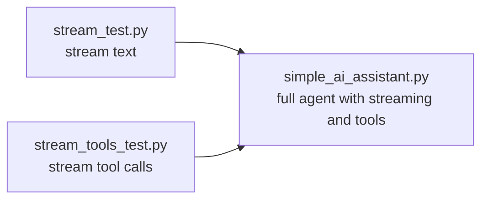
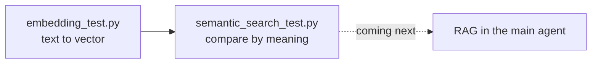

<div align="center">


</div>

<br/>

## 🧪 What is this folder?

These are **small, standalone snippets**, one for each feature we integrated step by step into the main agent code (`simple_ai_assistant.py`, `tools.py` and friends).

Each snippet isolates **one idea** so you can run it, break it and understand it *before* seeing it inside the full agent. Think of this folder as the lab, and the root of the repo as the finished product. 🔬➡️🚀

> 🎬 Part of the **Advanced AI** series on [codestorywithMIK](https://www.youtube.com/@codestorywithMIK).

<br/>

## 📂 Snippets

| File | Feature | What you learn |
|---|---|---|
| 📝 [`stream_test.py`](./stream_test.py) | **Streaming `message.content`** | Print the model's answer token by token as it is generated, instead of waiting for the full reply |
| 🔧 [`stream_tools_test.py`](./stream_tools_test.py) | **Streaming `tool_calls`** | Handle tool requests that arrive in small pieces while streaming, and put them together before running the tool |
| 🧬 [`embedding_test.py`](./embedding_test.py) | **Embeddings** | Turn text into a list of numbers (a vector) using an embedding model, and see that each text gets a vector of the same length |
| 🔍 [`semantic_search_test.py`](./semantic_search_test.py) | **Semantic search** | Compare texts by meaning using cosine similarity. "Python is a programming language" scores much closer to another Python sentence than to one about apples |
<br/>

## 🧩 How they connect to the main agent



Learn each piece alone first, then see how they combine in the real agent.

The embedding snippets are the foundation for **RAG**, which is planned for the main agent:



<br/>

## ⚡ How to run

Set up the project first by following the **Quick start** in the [main README](../README.md): Ollama running, model pulled, virtual environment active, `.env` created.

Then, from the **project root**:

```bash
python "Code Snippets/stream_test.py"
python "Code Snippets/stream_tools_test.py"
python "Code Snippets/embedding_test.py"
python "Code Snippets/semantic_search_test.py"
```

> 🧬 **Extra setup for the embedding snippets:**
> 1. Pull an embedding model, for example `ollama pull nomic-embed-text`.
> 2. Add `EMBED_MODEL=nomic-embed-text` to your `.env` (same rules as the other settings: no spaces around `=`, no quotes).
> 3. Install NumPy if it is not already installed: `pip install numpy` (and add it to `requirements.txt`).
<br/>

## 💡 Tips

- Read the snippet first, run it second, then compare it with the matching part of the main agent.
- Change one thing at a time (the prompt, the model, the tool) and watch what changes in the output.
- Small local models can be unpredictable with tools. If a snippet behaves oddly, try a larger model.
- For the embedding snippets, `EMBED_MODEL` must be an **embedding** model, not a chat model like `qwen3:4b`. Cosine similarity close to `1` means similar meaning, and close to `0` means unrelated.

<br/>

<div align="center">

### ⭐ If these snippets helped you, a star on the repo goes a long way!


</div>
