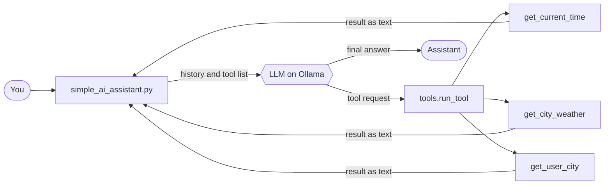

<div align="center">


<br/><br/>


<a href="https://www.youtube.com/watch?v=fMHGSx8B9gs&list=PLUqOqHuQynYk">
  
</a>
<a href="https://www.youtube.com/watch?v=f0HBW-47wwU&list=PLGSKQmIKK2zQ">
  
</a>

</div>

<br/>

## 🚀 What is this?


A **local AI agent built from scratch in Python**. It talks to a model running on [Ollama](https://ollama.com) through the OpenAI-compatible API, so there is **no paid key and no framework** hiding the logic.

It remembers the conversation, follows a system prompt, and can use tools **in several steps**. For example, it first finds your city, then fetches the weather for that city.

> 🎬 Built as part of the **Advanced AI** series on [codestorywithMIK](https://www.youtube.com/@codestorywithMIK).

> 📚 **New to AI?** Start with the [AI Fundamentals playlist](https://www.youtube.com/watch?v=fMHGSx8B9gs&list=PLUqOqHuQynYk) (tokens, embeddings, vector databases, RAG), then follow the [Advanced AI playlist](https://www.youtube.com/watch?v=f0HBW-47wwU&list=PLGSKQmIKK2zQ) where this project is built step by step.

> [!NOTE]
> 🌱 **Work in progress:** This project is in its early phase. As the Advanced AI playlist moves ahead, it will keep evolving, and we will add things like **RAG**, persistent memory and more tools.

<br clear="right"/>

<br/>

## 🎥 See it in action


<div align="center"><sub>The grey lines are the debug trace: you can watch the agent think.</sub></div>

<br/>

## ✨ Features

| | Feature | Details |
|---|---|---|
| 🧠 | **Conversation memory** | The full history is sent on every call, because the model itself has no memory |
| 🎭 | **System prompt** | Sets the agent's behavior and style |
| 🔧 | **Tool calling** | Tools are described with JSON schema and run by our own code |
| 🔗 | **Chained tool calls** | A loop with a step limit (`MAX_STEPS = 5`) so it can never run forever |
| 📝 | **Required parameters** | `get_city_weather` needs a `city`, declared in the schema |
| 🛡️ | **Safe errors** | Tool failures go back to the model as text, so the program does not crash |
| 🪲 | **Debug trace** | Grey step-by-step logs, switched on with `DEBUG=True` |

<br/>

## 🧩 How it works

The model **never runs code**. It only asks for a tool. Our Python code runs it, sends the result back, and the loop repeats until the model answers in plain text.



<details>
<summary><b>📖 The 4-step loop in words (click to expand)</b></summary>

1. We send the conversation plus the list of tools to the model.
2. The model replies with a **request** such as `get_city_weather(city="Bangalore")`, not an answer.
3. Our code runs the real function and sends the result back with the `tool` role.
4. The model reads the result and either asks for another tool or writes the final answer.

This repeats up to `MAX_STEPS` times per question.

</details>

<br/>

## 🛠️ Available tools

| Tool | What it does |
|---|---|
| `get_current_time` | Returns the current local date and time |
| `get_city_weather(city)` | One-line weather from the free `wttr.in` service |
| `get_user_city` | Returns the user's city (hard-coded to `Bangalore` as a demo value) |

<br/>

## ⚡ Quick start

**Prerequisites:** Python 3.10+ and [Ollama](https://ollama.com/download) installed and running.

```bash
# 1. Download the model
ollama pull qwen3:4b

# 2. Get the code
git clone https://github.com/MAZHARMIK/python-ai-agent-ollama.git
cd python-ai-agent-ollama

# 3. Create and activate a virtual environment
python -m venv .venv
# Windows:    .venv\Scripts\activate
# Mac/Linux:  source .venv/bin/activate

# 4. Install dependencies
pip install -r requirements.txt

# 5. Create your settings file
cp .env.example .env        # Windows: copy .env.example .env

# 6. Run
python simple_ai_assistant.py
```

Type `exit`, `quit`, `bye` or `goodbye` to stop.

<!-- SCREENSHOT 2: the terminal after step 6, showing the first prompt. -->


<br/>

## ⚙️ Configuration

Settings live in `.env` (see `.env.example`):

| Name | Meaning |
|---|---|
| `BASE_URL` | OpenAI-compatible endpoint. For Ollama: `http://127.0.0.1:11434/v1` |
| `API_KEY` | Required by the client, ignored by Ollama. Any dummy value works |
| `MODEL` | Exact model name from `ollama list`. It must support tool calling |
| `DEBUG` | Set to `True` (capital T) to show the grey debug trace |

> 💡 Rules for `.env`: `NAME=value`, no spaces around `=`, no quotes. Restart the program after editing it.

<br/>

## 📸 More screenshots


<br/>


<br/>

## ➕ Add your own tool

Three changes in `tools.py`, and the chat loop stays untouched:

1. ✍️ Write the Python function.
2. 📋 Add its description to the `TOOLS` list (name, description, parameters, `required`).
3. 🗺️ Register it in `FUNCTION_NAME_TO_FUNCTION_MAP`.

> The `description` matters: the model reads it to decide when to use the tool.

<br/>

## 📁 Project structure

```text
python-ai-agent-ollama/
├── simple_ai_assistant.py    chat loop, memory and the agent loop
├── tools.py                  tool functions, TOOLS schema, run_tool()
├── Utilities/
│   └── utilities.py          grey debug log() helper
├── .env.example              settings template
├── requirements.txt          dependencies
└── LICENSE                   MIT
```

<br/>

## ⚠️ Honest limitations

- Memory is kept in RAM and is lost when the program exits.
- The history is not trimmed, so very long chats can exceed the model's context window.
- Small local models can pick the wrong tool or skip arguments. A larger model is more reliable.
- `get_user_city` is a hard-coded demo value. In a real app it would come from a profile or database.
- The weather tool needs internet, and `wttr.in` is a free service that can be slow or down.
- Tool output is not treated as untrusted, which is why the tools are read-only.

<br/>

## 🎬 Video series

| # | Topic |
|---|---|
| 1 | Roadmap to master Advanced AI |
| 2 | Setup: VS Code, Python, Ollama |
| 3 | First AI call, OpenAI-style API |
| 4 | `.env`, chat loop, roles |
| 5 | Memory and context window |
| 6 | System prompt and prompt engineering basics |
| 7 | Tool calling |
| 8 | Tool with parameters (weather) |
| 9 | Chained tool calls |
| 10 | Refactoring, debug logging, bug fixes |

| Playlist | What it covers |
|---|---|
| ▶️ [**AI Fundamentals**](https://www.youtube.com/watch?v=fMHGSx8B9gs&list=PLUqOqHuQynYk) | Tokens, embeddings, vector databases and RAG. Watch this first if the basics are new to you |
| ▶️ [**Advanced AI**](https://www.youtube.com/watch?v=f0HBW-47wwU&list=PLGSKQmIKK2zQ) | This project, built step by step (videos 1 to 10 in the table above) |

<br/>

<div align="center">

### 🙌 If this helped you, a ⭐ goes a long way. Thank you!

[](https://www.youtube.com/@codestorywithMIK)
[](https://whatsapp.com/channel/0029Va6kVSjICVfiVdsHgi1A)
[](https://www.instagram.com/codestorywithmik/)
[](https://www.linkedin.com/in/mazhar-imam-khan-95a34ab3/)

<sub>Licensed under <a href="LICENSE">MIT</a></sub>


</div>
