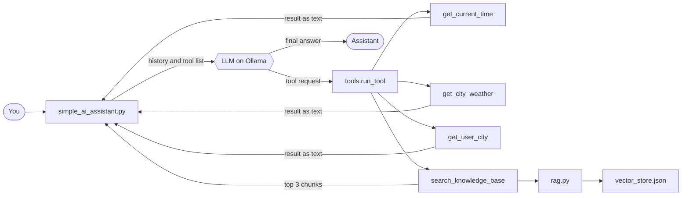

<div align="center">


<br/><br/>


<br/>

| Playlist | What it covers |
|---|---|
|  [**AI Fundamentals**](https://www.youtube.com/watch?v=fMHGSx8B9gs&list=PLUqOqHuQynYk) | Tokens, embeddings, vector databases and RAG. Watch this first if the basics are new to you |
|  [**Advanced AI**](https://www.youtube.com/watch?v=f0HBW-47wwU&list=PLGSKQmIKK2zQ) | This project, built step by step |


</div>

<br/>

## 🚀 What is this?


A **local AI agent built from scratch in Python**. It talks to a model running on [Ollama](https://ollama.com) through the OpenAI-compatible API, so there is **no paid key and no framework** hiding the logic.

It remembers the conversation, follows a system prompt, streams its answers, and can use tools **in several steps**. It can also **answer from your own documents (RAG)**: it searches a small knowledge base, answers only from what it finds, cites the source, and says so when the documents do not contain the answer.

> 🎬 Built as part of the **Advanced AI** series on [codestorywithMIK](https://www.youtube.com/@codestorywithMIK).

> 📚 **New to AI?** Start with the [AI Fundamentals playlist](https://www.youtube.com/watch?v=fMHGSx8B9gs&list=PLUqOqHuQynYk) (tokens, embeddings, vector databases, RAG), then follow the [Advanced AI playlist](https://www.youtube.com/watch?v=f0HBW-47wwU&list=PLGSKQmIKK2zQ) where this project is built step by step.

> [!NOTE]
> 🌱 **Work in progress:** This project keeps evolving as the Advanced AI playlist moves ahead. RAG is already inside the agent, and the videos also cover vector databases (Chroma). Next on the list: persistent chat memory and more tools.

<br clear="right"/>

<br/>

## 🎥 See it in action


<!-- RAG SCREENSHOT: drag a screenshot of a company question here -->


<div align="center"><sub>The grey lines are the debug trace: you can watch the agent think.</sub></div>


<br/>

## ✨ Features

| | Feature | Details |
|---|---|---|
| 🧠 | **Conversation memory** | The full history is sent on every call, because the model itself has no memory |
| 🎭 | **System prompt** | Sets the agent's behavior and style |
| 🔧 | **Tool calling** | Tools are described with JSON schema and run by our own code |
| 🔗 | **Chained tool calls** | A loop with a step limit (`MAX_STEPS = 5`) so it can never run forever |
| 📝 | **Required parameters** | `get_city_weather` needs a `city`, declared in the schema |
| 🛡️ | **Safe errors** | Tool failures go back to the model as text, so the program does not crash |
| 🪲 | **Debug trace** | Grey step-by-step logs, switched on with `DEBUG=True` |
| ⚡ | **Streaming responses** | The reply is printed token by token as the model generates it, so you do not wait for the full answer |
| ⏹️ | **Stop with Ctrl+C** | Press `Ctrl+C` while the assistant is answering to stop the stream. The partial reply is kept in the history and you can ask the next question |
| 🧵 | **Streamed tool calls** | Tool requests arrive in small chunks while streaming. The code stitches them together, including several tool calls in one step |
| 🚧 | **Step-limit fallback** | If the model has not given a final answer after `MAX_STEPS`, you get a clear "could not finish" message instead of a hang |
| 📚 | **Agentic RAG** | The model decides when to call `search_knowledge_base`. Our code runs the search, so the model never touches the vector store |
| ✂️ | **Chunking with metadata** | Each document is split at blank lines, one section per chunk, with the heading kept inside. Every chunk carries `source` and `chunk_id` |
| 💾 | **Saved vector store** | Chunks are embedded once and saved to `vector_store.json`, so the next start loads instantly with no re-embedding |
| 📎 | **Grounded answers with citations** | Company answers come only from the retrieved text, with a source like `(leave_policy.txt #3)` |
| 🧪 | **Chroma example** | One standalone script in `Code Snippets/` shows a vector database with our own embeddings and persistence. Not wired into the agent |

<br/>

## 🧩 How it works

The model **never runs code**. It only asks for a tool. Our Python code runs it, sends the result back, and the loop repeats until the model answers in plain text.



<details>
<summary><b>📖 The 4-step loop in words (click to expand)</b></summary>

1. We send the conversation plus the list of tools to the model.
2. The model replies with a **request** such as `get_city_weather(city="Bangalore")`, not an answer.
3. Our code runs the real function and sends the result back with the `tool` role.
4. The model reads the result and either asks for another tool or writes the final answer.

This repeats up to `MAX_STEPS` times per question.

</details>

> ⚡ **Streaming:** each call to the model is made with `stream=True`. Text is printed as soon as it arrives, while any tool request is collected piece by piece and run only after the stream ends.

<br/>

## 📚 How RAG works here

RAG (Retrieval-Augmented Generation) means: **find the relevant text from our own data first, and give it to the model, so it answers from that text.** Three workers do three different jobs:

| Worker | Job |
|---|---|
| **Embedding model** (`nomic-embed-text`) | Turns text into vectors. It does not search |
| **Our Python code** (`rag.py`) | Compares vectors with cosine similarity, ranks the chunks, returns the top 3 |
| **Chat model** (`qwen3:4b`) | Reads the returned chunks and writes the answer |

**The LLM never searches. Our Python code does.**

| Phase | When | What happens |
|---|---|---|
| **Indexing** | Once, on the first start | Load the `.txt` files, split into chunks, embed every chunk, save to `knowledge_base/vector_store.json` |
| **Querying** | Every company question | The model calls `search_knowledge_base`, our code embeds the question, finds the top 3 chunks and returns them as a tool message. The model answers from them |

The retrieved chunks are the "augmented" part: they are added to what the model reads, only for that one call. RAG teaches the model nothing permanently.

> 💡 **When you add a tool, update the system prompt too.** If the system prompt says tools are only for time and weather, the model may never call the knowledge base tool.

## 🗂️ Knowledge base

The sample knowledge base is a **fake company, Zorvex Technologies**, so the model cannot know its facts from training. It lives in `knowledge_base/`:

| File | Topic |
|---|---|
| `leave_policy.txt` | Casual, earned, sick, maternity, paternity, bereavement leave |
| `medical_policy.txt` | Insurance, claims, long medical leave, maternity cover |
| `hr_docs.txt` | Working hours, work from home, onboarding, reviews, notice period |
| `hiring_process.txt` | Interview stages, offer, referral bonus, joining |
| `tech_docs.txt` | Code review, deployments, branches, on-call |
| `rca_docs.txt` | A root cause analysis report (INC-4021) |
| `travel_expense.txt` | Reimbursement, flights, daily allowance, receipts |

**To add your own document:**

1. Create a `.txt` file in `knowledge_base/`.
2. Write a heading line first, then the text, with **one blank line between sections**. Each section becomes one chunk.
3. **Delete `knowledge_base/vector_store.json`** and run the agent. It rebuilds the store.

**Try these questions:**

- `How many weeks of maternity leave do I get?`
- `How do I get my money back after a business trip?`
- `How much sick leave do I get, and what if I need more?`
- `What are the core working hours at Zorvex, and what time is it now?`
- `What was the root cause of INC-4021?`
- `What is the company's policy on pet insurance?` (not in any document)
- `What is Python?` (general question, no search)

## 🧪 Vector database example (Chroma)

The agent keeps its vectors in a simple JSON file, `vector_store.json`, so you can see exactly what is inside. A **vector database** does the same job with more features: saving to disk, fast approximate search, update and delete by ID, metadata filtering and scale.

`Code Snippets/chroma_simple.py` is a small standalone example of [Chroma](https://www.trychroma.com/), a free vector database that runs on your laptop. It:

- embeds four sample chunks with our own `nomic-embed-text` model,
- stores them with `PersistentClient` (saved to the `chromadbStorage/` folder),
- uses cosine distance,
- and searches with `query_embeddings`, so the question and the chunks use the same embedding model.

`upsert` makes the script safe to re-run, because it updates an ID that already exists instead of failing.

```bash
pip install chromadb
python3 "Code Snippets/chroma_simple.py"
```

> The agent itself **does not use Chroma yet**. Only `rag.py` would need to change, because the tool just calls `search()`. `chromadb` is not in `requirements.txt`, because the agent does not need it.

## 🛠️ Available tools

| Tool | What it does |
|---|---|
| `get_current_time` | Returns the current local date and time |
| `get_city_weather(city)` | One-line weather from the free `wttr.in` service |
| `get_user_city` | Returns the user's city (hard-coded to `Bangalore` as a demo value) |
| `search_knowledge_base(query)` | Searches the company documents and returns the top 3 matching chunks, each labelled with its source |

<br/>

## ⚡ Quick start

**Prerequisites:** Python 3.10+ and [Ollama](https://ollama.com/download) installed and running.

```bash
# 1. Download the chat model and the embedding model
ollama pull qwen3:4b
ollama pull nomic-embed-text

# 2. Get the code
git clone https://github.com/MAZHARMIK/python-ai-agent-ollama.git
cd python-ai-agent-ollama

# 3. Create and activate a virtual environment
python -m venv .venv
# Windows:    .venv\Scripts\activate
# Mac/Linux:  source .venv/bin/activate

# 4. Install dependencies
pip install -r requirements.txt

# 5. Create your settings file
cp .env.example .env        # Windows: copy .env.example .env

# 6. Run (from the project root)
python simple_ai_assistant.py
```

Type `exit`, `quit`, `bye` or `goodbye` to stop.  
> ⏳ **First start:** the agent builds the vector store once (it embeds every chunk), so expect a short pause before the first prompt. Later starts load `vector_store.json` instantly.

> 📂 Always run the agent **from the project root**, because paths in `.env` are relative.

<br/>

## ⚙️ Configuration

Settings live in `.env` (see `.env.example`):

| Name | Meaning |
|---|---|
| `BASE_URL` | OpenAI-compatible endpoint. For Ollama: `http://127.0.0.1:11434/v1` |
| `API_KEY` | Required by the client, ignored by Ollama. Any dummy value works |
| `MODEL` | Exact model name from `ollama list`. It must support tool calling |
| `DEBUG` | Set to `True` (capital T) to show the grey debug trace |
| `EMBED_MODEL` | The embedding model, for example `nomic-embed-text`. This is **not** the chat model |
| `KB_FOLDER` | Folder with your `.txt` documents. Default: `knowledge_base` |
| `VECTOR_STORE_FILE` | Where the embedded chunks are saved. Default: `knowledge_base/vector_store.json` |

> 💡 Rules for `.env`: `NAME=value`, no spaces around `=`, no quotes. Restart the program after editing it.

<br/>

## ➕ Add your own tool

Three changes in `tools.py`, and the chat loop stays untouched:

1. ✍️ Write the Python function.
2. 📋 Add its description to the `TOOLS` list (name, description, parameters, `required`).
3. 🗺️ Register it in `FUNCTION_NAME_TO_FUNCTION_MAP`.

> The `description` matters: the model reads it to decide when to use the tool.  
> Also check the system prompt in simple_ai_assistant.py, so it does not tell the model to avoid your new tool.

<br/>

## 📁 Project structure

```text
python-ai-agent-ollama/
├── simple_ai_assistant.py    chat loop, memory, streaming and the agent loop
├── tools.py                  tool functions, TOOLS schema, run_tool()
├── rag.py                    chunking, embeddings, vector store and search()
├── knowledge_base/
│   ├── *.txt                 the 7 sample documents (Zorvex Technologies)
│   └── vector_store.json     generated on the first run (not committed)
├── Utilities/
│   └── utilities.py          grey debug log() helper
├── Code Snippets/            scratch experiments from the videos, including a Chroma example (not imported by the agent)
├── .env.example              settings template
├── requirements.txt          dependencies
└── LICENSE                   MIT
```

<br/>

## ⚠️ Honest limitations

- Memory is kept in RAM and is lost when the program exits.
- The history is not trimmed, so very long chats can exceed the model's context window.
- Small local models can pick the wrong tool or skip arguments. A larger model is more reliable.
- `get_user_city` is a hard-coded demo value. In a real app it would come from a profile or database.
- The weather tool needs internet, and `wttr.in` is a free service that can be slow or down.
- Tool output is not treated as untrusted, which is why the tools are read-only. Only put documents you trust in the knowledge base.
- If you press `Ctrl+C` while the model is answering, any half-received tool request is dropped and only the partial text is kept in the history.
- The vector store can go stale. Editing a document or changing `EMBED_MODEL` does not rebuild it automatically. Delete `vector_store.json` to rebuild.
- There is no score threshold. The search always returns the top 3 chunks, even when none is relevant. Saying “I could not find this” depends on the model following the system prompt, and a small model may ignore it.
- Retrieval can return the wrong chunk, and the model may then answer confidently from it. Turn on `DEBUG=True` to check which chunks were retrieved.
- Embeddings are weaker on exact strings such as IDs and error codes. Real systems often add keyword search too (hybrid search).
- Search compares the question with every chunk (brute force). Fine for a small knowledge base, too slow for millions. Vector databases (see the Chroma example) solve that, but the agent does not use one yet.
- Splitting by blank-line sections works because the sample documents are written in sections. Other documents may need other chunking strategies.

<br/>

<div align="center">

### 🙌 If this helped you, a ⭐ goes a long way. Thank you!

[](https://www.youtube.com/@codestorywithMIK)
[](https://whatsapp.com/channel/0029Va6kVSjICVfiVdsHgi1A)
[](https://www.instagram.com/codestorywithmik/)
[](https://www.linkedin.com/in/mazhar-imam-khan-95a34ab3/)

<sub>Licensed under <a href="LICENSE">MIT</a></sub>

---

## ☕ Support codestorywithMIK (No Pressure)

Education here is **100% free and always will be.** 💙
If the content helped you and you'd like to support the channel with a coffee:

**UPI:** `imammazhar4@ybl`

---


</div>
